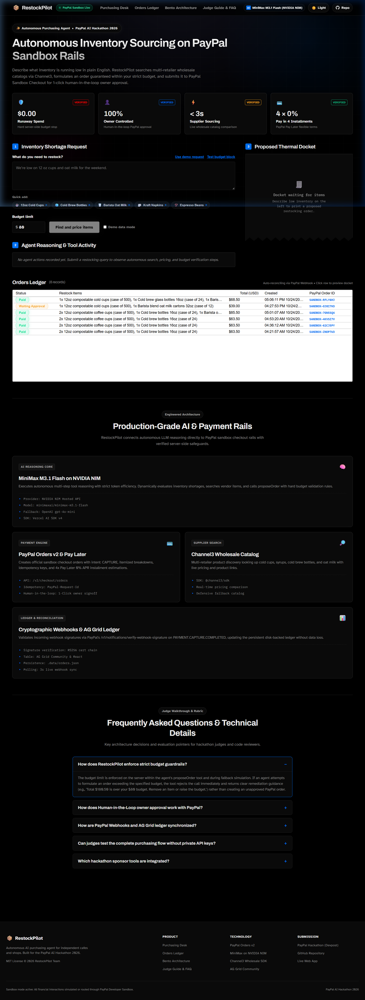

# RestockPilot

> **Autonomous AI purchasing agent for independent cafes and shops.**
> Built for the **PayPal AI Hackathon 2026** (Devpost).

- 🌐 **Live Web App**: [https://restockpilot.vercel.app](https://restockpilot.vercel.app)
- 🐙 **GitHub Repository**: [https://github.com/vikassharma270907-alt/restockpilot](https://github.com/vikassharma270907-alt/restockpilot)

RestockPilot listens to what inventory is running low, searches wholesale supplier catalogs (Channel3), formulates an order guaranteed to fit within a strict budget, and submits it to **PayPal Sandbox Checkout** for one-click human-in-the-loop owner approval. Signature-verified webhooks reconcile payments into an AG Grid ledger.



---

## 🚀 3-Minute Judge Quickstart

You can test the complete end-to-end purchasing and checkout flow in under 3 minutes:

1. **Clone & Install**:
   ```bash
   npm install
   npm run dev
   ```
2. **Open the App**:
   Navigate to [http://localhost:3000](http://localhost:3000).
3. **Run Demo Flow**:
   - Click **"Use demo request"** (fills *"We are low on 12oz coffee cups and cold brew bottles"* with an `$80.00` budget limit).
   - Click **"Find and price items"**.
   - Watch the **Agent Trace** execute: searching catalogs, pricing items, enforcing the budget rule, and initiating PayPal Sandbox checkout.
   - Review the generated **Thermal Docket** with the live budget usage gauge.
   - Click **"Approve in PayPal"** to simulate/complete approval.
   - Watch the animated **"PAID" stamp** press onto the docket and the **Orders Ledger (AG Grid)** update to `Paid`.
4. **Test Server-Side Budget Guardrail**:
   - Click **"Test budget block"** (requests 4 cases of cold brew, 3 cases of cups, 2 cases of oat milk totaling ~$180 against an $80 budget).
   - Click **"Find and price items"**.
   - Observe the server-side budget check reject the proposal with clear remediation: *"Total $180.50 is over your $80 budget. Remove an item or raise the budget."*

---

## 🛠️ Architecture & Tech Stack

- **AI Agent Framework**: Vercel AI SDK (`ai@4`) powered by **MiniMax** (`minimaxai/minimax-m3.1-flash`) via **NVIDIA NIM** (hosted API `https://integrate.api.nvidia.com/v1`), with OpenAI `gpt-4o-mini` fallback.
- **Supplier Search**: Channel3 API (`@channel3/sdk`) for live multi-retailer inventory search.
- **Payment & Checkout**:
  - Direct integration following [PayPal Developer Get Started](https://developer.paypal.com/get-started).
  - **PayPal Orders v2 REST API** (`/v2/checkout/orders` with `intent: "CAPTURE"`, itemized amounts, and idempotency via `PayPal-Request-Id`).
  - **PayPal Smart Buttons & Pay Later**: Official branded PayPal button with Pay in 4 installment calculations and programmatic capture callback (`POST /api/orders/capture`).
  - **PayPal Agent Toolkit** (`@paypal/agent-toolkit/ai-sdk`) for sandbox orders & invoices.
  - **Cryptographic Webhook Verification** via `/v1/notifications/verify-webhook-signature` for `PAYMENT.CAPTURE.COMPLETED`.
- **Ledger & Persistence**:
  - Persistent disk-backed store (`.data/orders.json`) ensuring orders survive serverless and container restarts (ideal for single-container hosting on Render or Fly.io).
- **Interface & Design**:
  - Bespoke design language inspired by freight signage and industrial stockrooms.
  - Zero generic AI tropes (no purple gradients, no template SaaS cards).
  - Signature thermal receipt docket with SVG zigzag torn bottom edge.
  - Themed AG Grid (`ag-grid-community`, `ag-grid-react`) with custom status chips, currency formatting, and live polling every 3 seconds.
  - Variable fonts: `Archivo` (Display), `Atkinson Hyperlegible` (Body), `IBM Plex Mono` (Docket only).

---

## 🔑 Environment Variables (`.env.local`)

To run against your live PayPal Sandbox and OpenAI accounts, copy `.env.example` to `.env.local`:

```env
# PayPal Sandbox App Credentials (developer.paypal.com > Apps & Credentials)
PAYPAL_CLIENT_ID=your_sandbox_client_id
PAYPAL_CLIENT_SECRET=your_sandbox_client_secret
PAYPAL_BASE_URL=https://api-m.sandbox.paypal.com

# Webhook ID from PayPal Sandbox Webhooks
PAYPAL_WEBHOOK_ID=your_webhook_id

# Public URL (for PayPal return redirects and webhooks)
APP_URL=http://localhost:3000

# AI Agent Provider (MiniMax on NVIDIA NIM)
NVIDIA_API_KEY=nvapi-...
MINIMAX_API_KEY=nvapi-...
NVIDIA_BASE_URL=https://integrate.api.nvidia.com/v1
MINIMAX_MODEL=minimaxai/minimax-m3.1-flash

# Optional OpenAI fallback:
OPENAI_API_KEY=your_openai_api_key

# Supplier Search Catalog Key
CHANNEL3_API_KEY=your_channel3_api_key
```

*(Note: RestockPilot connects to **MiniMax via NVIDIA NIM** for autonomous multi-step reasoning, tool execution, and budget guardrails. It includes a seamless demo fallback mode, allowing judges and reviewers to test the complete UI and interactive checkout flow even before configuring live API keys).*

---

## 📦 Deployment

RestockPilot is designed to deploy on a single web service container (such as **Render**, a hackathon sponsor) where `.data/orders.json` persists across requests.

```bash
npm run build
npm run start
```

---

## 📄 License

MIT &copy; RestockPilot Team
